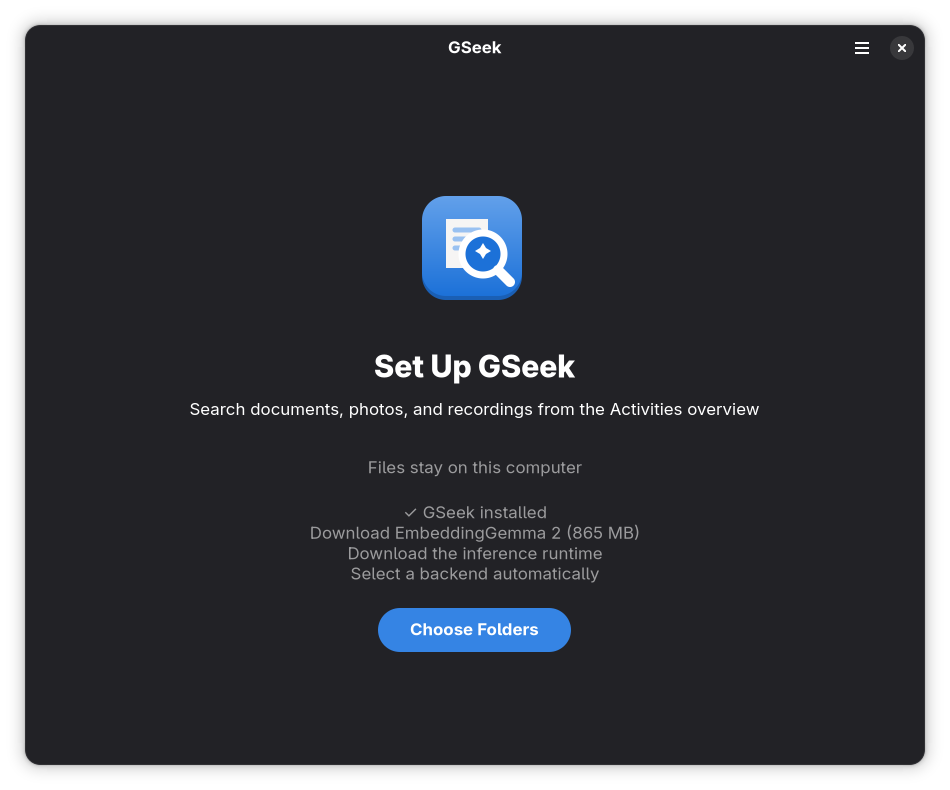
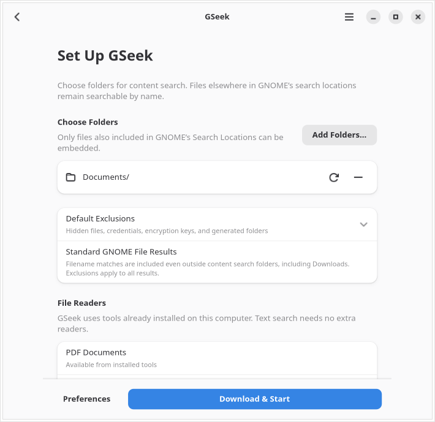
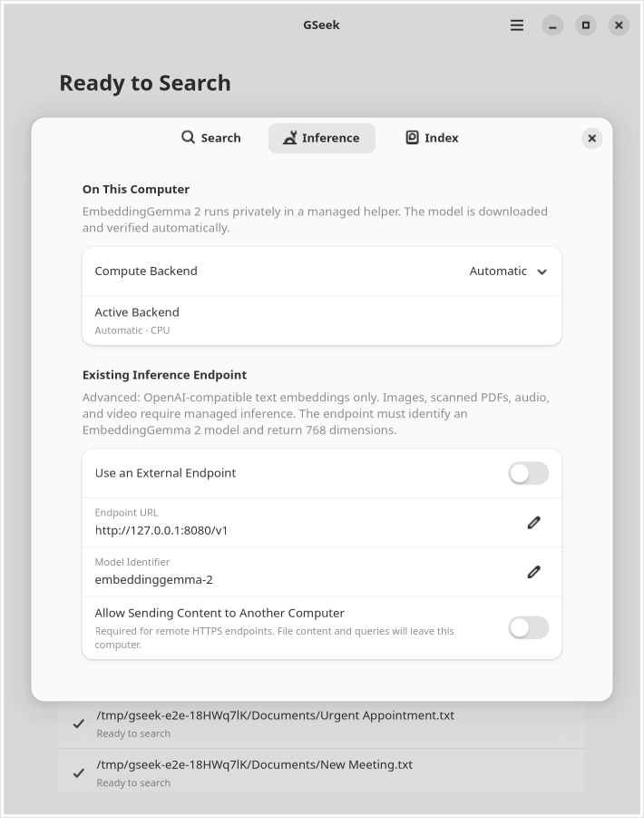
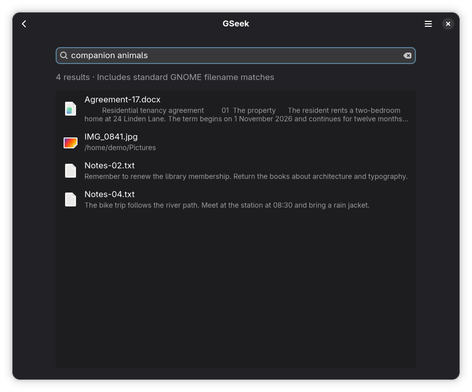

<p align="center"></p>
<h1 align="center">GSeek</h1>
<p align="center"><b>Find your files by what you remember.</b><br>
Private, multilingual search in GNOME Activities, powered by
<a href="https://huggingface.co/google/embeddinggemma-2">EmbeddingGemma 2</a>.</p>
<p align="center"><a href="#install"><b>Install with Flatpak</b></a> ·
<a href="https://github.com/FarisZR/GSeek/releases/latest">Releases</a> ·
<a href="docs/DEVELOPMENT.md">Build and contribute</a><br>
<sub>Native GTK4 and libadwaita. No account. No telemetry.</sub></p>

<p align="center"></p>

Describe a document, picture, or moment in a recording. GSeek finds the match in
the GNOME overview you already use. The native app manages setup, indexing
activity, and preferences.

## What you can find

- **Meaning:** “the clause about pets in my lease” finds the agreement, even if its filename tells you nothing.
- **Languages:** search in German for an English document, or in Arabic for a German invoice. English, German, Arabic, and cross-language retrieval are tested with the real model.
- **Exact details:** filenames, paths, invoice numbers, and words inside documents contribute to ranking alongside semantic similarity.
- **Media:** pictures and screenshots, PDF text and scanned pages, audio segments, and sampled video frames share the model’s embedding space.
- **Your usual files:** native file icons, existing thumbnails, folders, and opening results in their default applications.

## Install

GSeek targets **GNOME 51**, including Fedora Workstation 45 and Ubuntu 26.10,
on Linux **x86-64 and ARM64**. Install [Flatpak](https://flatpak.org/setup/) for
your distribution, then open [Install GSeek](https://flatpak.fariszr.com/gseek.flatpakref)
in GNOME Software, or run:

```sh
flatpak install --user https://flatpak.fariszr.com/gseek.flatpakref
```

Packages come from [FarisZR’s signed repository](https://flatpak.fariszr.com),
hosted on Cloudflare Pages. GSeek is not published on Flathub; the shared GNOME
runtime comes from Flathub. No administrator access is needed for a user installation.

<p align="center"></p>

1. Open **GSeek** and select **Choose Folders**.
2. Choose folders to embed. Downloads is not selected by default. Folders must also be enabled in **GNOME Settings → Search → Search Locations**; LocalSearch handles discovery.
3. Choose **Download & Start** and allow background activity. The verified model downloads once, about **865 MB**, along with the selected official inference runtime.
4. In **Search Settings**, enable GSeek and turn off Files to avoid duplicate filename results. Search from Activities.

<p align="center"></p>

Closing the window keeps indexing and overview search running. The background
portal controls startup at login. Your software manager handles updates, or run
`flatpak update`. GSeek restarts its running service after an update is installed,
reopening its window only if it was already open. **Restart GSeek** is also in the
main menu (`flatpak run com.fariszr.gseek restart` from a terminal).

Settings, indexes, and verified downloads live in
`~/.var/app/com.fariszr.gseek/` and survive updates and normal uninstall/reinstall.
Use `flatpak uninstall --delete-data com.fariszr.gseek` to remove them too.

## Included file readers and sandbox permissions

The Flatpak includes everything needed to read documents and media. It uses the
shared GNOME platform for GTK, libadwaita, TinySPARQL, FFmpeg, unzip, and graphics
drivers, and packages Poppler’s PDF readers. No host reader installation or
inference engine compilation is required.

| Formats | Included programs |
| --- | --- |
| PDFs, including scanned pages | `pdfinfo`, `pdftotext`, `pdftoppm` |
| Images, audio, video | `ffmpeg`, `ffprobe` |
| DOCX, ODT | `unzip` |

GSeek needs read-only access to files so it can read the paths supplied by your
host’s LocalSearch index, including removable drives. Its own data stays writable.
Network access downloads verified models/runtimes and supports an optional
explicitly configured endpoint. GPU access supports Vulkan and NVIDIA drivers.
Targeted D-Bus permissions access LocalSearch and open GNOME’s Search Settings.
There is no unrestricted session-bus or host-command permission.

## Indexing you can control

<p align="center"></p>

Pause and resume, index now, retry failed files, or reindex a single location or
the whole library. Activity shows the current file, completed work, skipped
formats, and failure details. Preferences cover included and excluded folders,
file types, hardware, and advanced inference settings.

Preferences save changes immediately. Select multiple folders at once to include
or exclude them. Exclusions remove queued files and their unreferenced vectors
from the index immediately, including saved checkpoints. Activity and Inference
preferences show the backend Automatic actually selected. Switching backends
interrupts the previous worker, reports download/startup progress, and preserves
an explicit choice if its driver or memory allocation fails.

**Preferences → Inference → Active Backend** shows the selected runtime and
the device it actually uses, including software Vulkan on the CPU. During a
switch, **Inference Status** shows download and startup progress. If CUDA or
another explicit backend cannot start, its selection stays saved and the error
appears here with **Retry**. Choose Automatic or another working backend to
resume indexing; there is no separate Apply step.

<p align="center"></p>

GSeek also queries GNOME’s filename index directly, including Downloads and
formats without a content reader. These files stay out of the embedding queue;
they appear in Activities without enabling a second Files provider. Explicit
folder and extension exclusions apply to all GSeek results.

LocalSearch notifications pick up new, changed, renamed, and deleted files.
Periodic reconciliation repairs missed events. Content hashes reuse embeddings
for unchanged files and renames. Each document or media part is checkpointed,
so a restart preserves progress. Background indexing runs at low priority;
interactive search uses a separate inference worker.

Defaults focus on your XDG document and media folders. Hidden directories,
credentials, caches, dependency directories, container storage, and build outputs
are excluded. GSeek does not crawl your home directory independently of GNOME.

## Search Results

Select GSeek’s **Show All Results** action in Activities to open a native results
view with the same query. It shows content matches and standard GNOME filename
matches together. Search again with the search field or **Ctrl+F**, and open a
file by activating its row. Folder and exclusion changes refresh an open results
view automatically. The window is reused when another query arrives from
Activities. Large result sets use a virtualized list; searches return up to 5,000
matches and ask you to refine the query if that limit is reached.

Results use filename quality, GNOME LocalSearch rank, document text, meaning,
and GNOME's last-access/modification recency. Exact filenames and titles take
priority; matching document text helps distinguish similarly named copies.
There is no blanket preference for Documents or Downloads and no query-history
tracking. GNOME's global search behavior is the baseline; folder proximity is
not used.

Activities shows one representative of byte-identical copies **only when an
existing, still-current content hash proves they are identical**. The full
results window keeps the other copies after distinct results. Unhashed files,
changed files, and different revisions remain separate. Matching passages are
preserved so opening a result takes you to the relevant page or moment.

Filename and previously indexed text search remain available while the model
starts, is busy, or fails. The results window explains when
semantic search is unavailable. A slow model does not hold up filename lookup
while you type. Semantic, multilingual, and multimodal retrieval still uses the
same local model; no new model or dependency is installed for ranking.
See the [ranking evaluation](docs/SEARCH_EVALUATION.md) for the regression corpus,
stock GNOME Files comparison, measured latency, and limits of the results.

<p align="center"></p>

## Default Exclusions

Setup and Preferences show **Default Exclusions**, including the full extension
list. These defaults apply to content embedding and GNOME filename results.
Additional excluded folders and extensions can be set in Preferences.

| Excluded by default | Names or extensions |
| --- | --- |
| Hidden files and folders | Any name beginning with `.`, including `.env`, `.ssh`, and `.git` |
| Encryption, keys, certificates, and password databases | `.key`, `.pem`, `.p12`, `.pfx`, `.kdbx`, `.gpg`, `.pgp`, `.asc`, `.age`, `.keystore`, `.jks`, `.kdb`, `.der`, `.crt`, `.cer`, `.psafe3`, `.ibak` |
| Credential filenames | `credentials`, `credentials.json`, `secrets.json`, `passwords.txt`, `id_rsa`, `id_ed25519`, `id_dsa`, `id_ecdsa`, `authorized_keys`, `known_hosts` |
| Generated folders | `node_modules`, `target`, `build`, `dist`, `vendor`, `venv`, `__pycache__`, `containers`, `lost+found` |

Downloads is excluded from **new setups’ content folders**, so it is not embedded
by default. Files there still appear by name when GNOME indexes them. Existing
folder choices are preserved during upgrades.

## Hardware

| Backend | Availability |
| --- | --- |
| CPU | Managed upstream download on x86-64 and ARM64; automatic fallback when GPU initialization fails |
| Vulkan | Managed upstream download; AMD and Intel GPUs with a working Vulkan driver; software Vulkan is tested in CI |
| NVIDIA CUDA | Managed upstream download on x86-64 and ARM64, including CUDA redistributable libraries; requires a compatible NVIDIA driver |

Automatic selection tries CUDA on NVIDIA, Vulkan when a render device is
available, then CPU. Explicit selections report failures instead of silently
switching. AMD cards, including the RX 6700 XT, use Vulkan without ROCm overrides.

GSeek downloads unmodified, version-pinned [official llama.cpp binaries](https://github.com/ggml-org/llama.cpp/releases/tag/b11669)
and verifies their sizes and SHA-256 checksums. It builds no inference engine or
GPU SDK. CPU and real software-Vulkan inference run in CI; physical GPU
performance and driver compatibility still need testing on representative machines.

Activity and Inference preferences show the device reported by the running
runtime, for example **Vulkan · GPU · AMD Radeon 780M** or
**Vulkan · Software CPU · llvmpipe**. If memory fitting offloads no model layers,
the status says **CPU · no GPU layers**. An unreported device is labeled explicitly
instead of assuming GPU acceleration.

## Private by default

Managed inference runs on your computer. Network access downloads checksummed
model files and the selected checksummed upstream runtime. There is no telemetry or
in-app update polling; Flatpak and your software manager install updates.

Advanced users can configure an OpenAI-compatible **text embedding** endpoint.
GSeek validates EmbeddingGemma 2’s dimensions and a reference embedding before
using it. This mode does not assume a multimodal API: images, scanned-PDF visual
pages, audio, and video require managed inference. Remote endpoints require HTTPS
and explicit consent to upload content. Localhost requests bypass HTTP proxies.

**Semantic search needs working embeddings.** If inference fails, GSeek shows
the reason and recovery controls. Ordinary GNOME filename results and previously
indexed document text remain searchable; meaning-only queries need the model.

## Current limits

PDF text and visual pages, plain-text formats, DOCX, ODT, images, audio, and video
are supported. Audio uses overlapping 30-second windows every 25 seconds; video frames every
10 seconds. Text is split using the model’s tokenizer when it exceeds the runtime’s input budget; no text is discarded. Activity explains files that cannot be embedded.
Results retain page or timestamp context but open in the default app, without
promising page seeking across unrelated viewers.

The vector index uses a bounded-memory exact scan in SQLite. Search quality and
initial indexing time depend on your library and hardware. Libraries with millions
of media segments will need further performance work; indexing hundreds of
gigabytes is a background task.

## Development and testing

See [Development](docs/DEVELOPMENT.md) for builds, real-model tests, headless GNOME
checks, and release packaging, and [Architecture](docs/ARCHITECTURE.md) for process
boundaries and storage contracts.

GitHub Actions covers GNOME 51 on Fedora 45 and Ubuntu 26.10, CPU and Vulkan,
Flatpak builds and sandboxed CPU inference on both architectures, native GTK views, actual overview
search, multilingual retrieval, multimodal readers, database migrations, progress
recovery, provider metadata and activation, and explicit inference failures.

GSeek is GPL-3.0-or-later; the upstream inference runtime is MIT. Thanks to
[DigUp](https://github.com/ARahim3/DigUp) for demonstrating a simple on-device
EmbeddingGemma 2 experience. See [Third-party components](docs/THIRD_PARTY.md).
