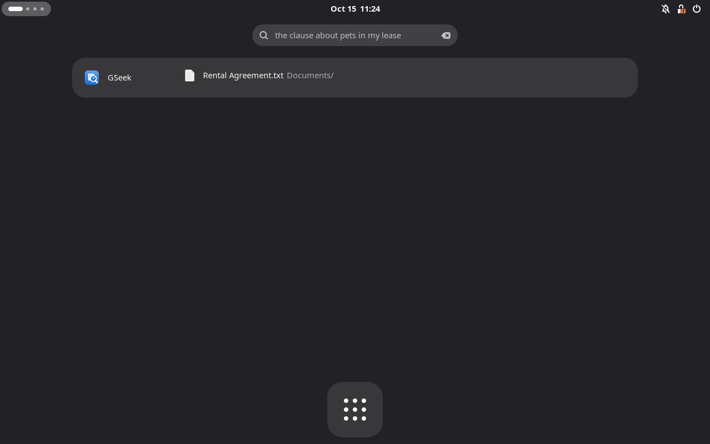
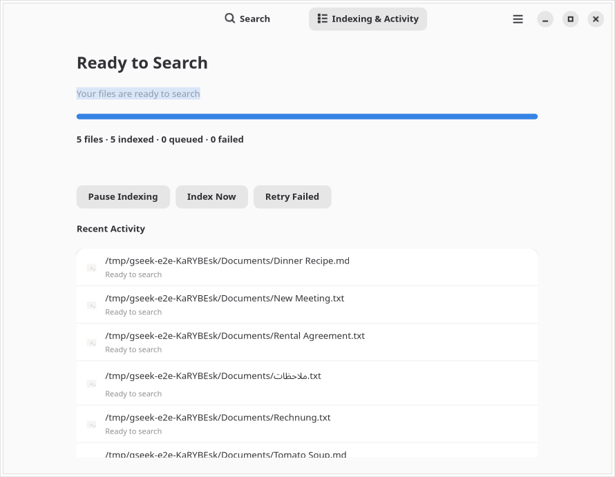

<p align="center"></p>
<h1 align="center">GSeek</h1>
<p align="center"><b>Find your files by what you remember.</b><br>
Private, multilingual search in GNOME Activities, powered by
<a href="https://huggingface.co/google/embeddinggemma-2">EmbeddingGemma 2</a>.</p>
<p align="center"><a href="#install"><b>Install with Homebrew</b></a> ·
<a href="https://github.com/FarisZR/GSeek/releases/latest">Releases</a> ·
<a href="docs/DEVELOPMENT.md">Build and contribute</a><br>
<sub>Native GTK4 and libadwaita. No account. No telemetry.</sub></p>

<p align="center"></p>

Describe a document, picture, or moment in a recording. GSeek finds the match in
the GNOME overview you already use. The native app manages setup, indexing
activity, and preferences.

## What you can find

- **Meaning:** “the clause about pets in my lease” finds the agreement, even if its filename tells you nothing.
- **Languages:** search in German for an English document, or in Arabic for a German invoice. English, German, Arabic, and cross-language retrieval are tested with the real model.
- **Exact details:** filenames, paths, invoice numbers, and words inside documents contribute to ranking alongside semantic similarity.
- **Media:** pictures and screenshots, PDF text and scanned pages, audio segments, and sampled video frames share the model’s embedding space.
- **Your usual files:** native file icons, existing thumbnails, folders, and opening results in their default applications.

## Install

GSeek targets **GNOME 51**, including Fedora Workstation 45 and Ubuntu 26.10, on
Linux **x86-64 and ARM64**. Other distributions need a compatible GNOME desktop,
LocalSearch, and glibc 2.39 or newer. GSeek uses your desktop’s native GTK and
LocalSearch libraries.

With [Homebrew](https://brew.sh) 6 or newer:

```sh
brew update
brew tap fariszr/tap
brew trust fariszr/tap
brew install --cask gseek
```

Homebrew installs the app, desktop entry, background activation,
and search provider. It asks for administrator permission to place the small
provider registration in GNOME’s system data directory.

1. Open **GSeek** from the app menu and select **Set Up Search**.
2. Pick your folders. They must also be enabled in **GNOME Settings → Search → Search Locations**; GSeek uses LocalSearch’s existing discovery index.
3. Choose **Download & Start**. The verified model downloads once, about **865 MB**, along with the selected upstream runtime.
4. Search from Activities. Setup enables GSeek and disables the Files search provider after inference is ready.

There is no inference server or SDK to install. Closing the window keeps indexing
and overview search running. Update with `brew upgrade --cask gseek`.

Uninstalling with `brew uninstall --cask gseek` removes desktop integration and
restores the Files provider’s previous setting. Your local library and settings
are kept so a reinstall can reuse them.

## System readers

GSeek reuses your desktop’s GTK, libadwaita, LocalSearch, and installed content
readers. The cask does **not** install Homebrew’s FFmpeg, Poppler, audio stack, or
codec tree. On a host with OpenSSL 3, it requests **zero Homebrew formulas**.
Only hosts missing that ABI need the small `openssl@3` compatibility dependency
for the official inference binary; it is isolated from GNOME’s libraries.

Text files need no additional readers. Setup and Preferences show which other
formats are available:

| Formats | Existing system programs |
| --- | --- |
| PDFs, including scanned pages | `pdfinfo`, `pdftotext`, `pdftoppm` (`poppler-utils`) |
| Images, audio, video | `ffmpeg`, `ffprobe` |
| DOCX, ODT | `unzip` |

If you want these formats and the tools are missing, install them through your
**distribution’s** package manager (`ffmpeg-free` on Fedora, `ffmpeg` on Ubuntu;
`poppler-utils` and `unzip` on both). Already installed tools are reused. Missing
readers produce an actionable error for affected files; choose **Retry Failed**
after installing them. GSeek still requires working embeddings for every search.
The base system’s `tar` unpacks verified upstream runtimes.

## Indexing you can control

<p align="center"></p>

Pause and resume, index now, retry failed files, or reindex a single location or
the whole library. Activity shows the current file, completed work, skipped
formats, and failure details. Preferences cover included and excluded folders,
file types, hardware, and advanced inference settings.

Preferences save changes immediately. Select multiple folders at once to include
or exclude them. Exclusions remove queued files and their unreferenced vectors
from the index immediately, including saved checkpoints. Activity and Inference
preferences show the backend Automatic actually selected. Switching backends
interrupts the previous worker, reports download/startup progress, and preserves
an explicit choice if its driver or memory allocation fails.

LocalSearch notifications pick up new, changed, renamed, and deleted files.
Periodic reconciliation repairs missed events. Content hashes reuse embeddings
for unchanged files and renames. Each document or media part is checkpointed,
so a restart preserves progress. Background indexing runs at low priority;
interactive search uses a separate inference worker.

Defaults focus on your XDG document and media folders. Hidden directories,
credentials, caches, dependency directories, container storage, and build outputs
are excluded. GSeek does not crawl your home directory independently of GNOME.

## Hardware

| Backend | Availability |
| --- | --- |
| CPU | Managed upstream download on x86-64 and ARM64; automatic fallback when GPU initialization fails |
| Vulkan | Managed upstream download; AMD and Intel GPUs with a working Vulkan driver; software Vulkan is tested in CI |
| NVIDIA CUDA | Managed upstream download on x86-64 and ARM64, including CUDA redistributable libraries; requires a compatible NVIDIA driver |

Automatic selection tries CUDA on NVIDIA, Vulkan when a render device is
available, then CPU. Explicit selections report failures instead of silently
switching. AMD cards, including the RX 6700 XT, use Vulkan without ROCm overrides.

GSeek downloads unmodified, version-pinned [official llama.cpp binaries](https://github.com/ggml-org/llama.cpp/releases/tag/b11669)
and verifies their sizes and SHA-256 checksums. It builds no inference engine or
GPU SDK. CPU and real software-Vulkan inference run in CI; physical GPU
performance and driver compatibility still need testing on representative machines.

## Private by default

Managed inference runs on your computer. Network access downloads checksummed
model files and the selected checksummed upstream runtime. There is no telemetry or
in-app update polling; Homebrew manages updates.

Advanced users can configure an OpenAI-compatible **text embedding** endpoint.
GSeek validates EmbeddingGemma 2’s dimensions and a reference embedding before
using it. This mode does not assume a multimodal API: images, scanned-PDF visual
pages, audio, and video require managed inference. Remote endpoints require HTTPS
and explicit consent to upload content. Localhost requests bypass HTTP proxies.

**Working embeddings are required.** If inference fails, GSeek shows the error
and recovery controls; it does not quietly turn into filename-only search.

## Current limits

PDF text and visual pages, plain-text formats, DOCX, ODT, images, audio, and video
are supported. Audio uses overlapping 30-second windows every 25 seconds; video frames every
10 seconds. Limits bound very large inputs; Activity explains skipped files.
Results retain page or timestamp context but open in the default app, without
promising page seeking across unrelated viewers.

The vector index uses a bounded-memory exact scan in SQLite. Search quality and
initial indexing time depend on your library and hardware. Libraries with millions
of media segments will need further performance work; indexing hundreds of
gigabytes is a background task.

## Development and testing

See [Development](docs/DEVELOPMENT.md) for builds, real-model tests, headless GNOME
checks, and release packaging, and [Architecture](docs/ARCHITECTURE.md) for process
boundaries and storage contracts.

GitHub Actions covers GNOME 51 on Fedora 45 and Ubuntu 26.10, CPU and Vulkan,
Homebrew lifecycle and installation/link checks for all three upstream runtimes
on both architectures, native GTK views, actual overview
search, multilingual retrieval, multimodal readers, database migrations, progress
recovery, provider metadata and activation, and explicit inference failures.

GSeek is GPL-3.0-or-later; the upstream inference runtime is MIT. Thanks to
[DigUp](https://github.com/ARahim3/DigUp) for demonstrating a simple on-device
EmbeddingGemma 2 experience. See [Third-party components](docs/THIRD_PARTY.md).
